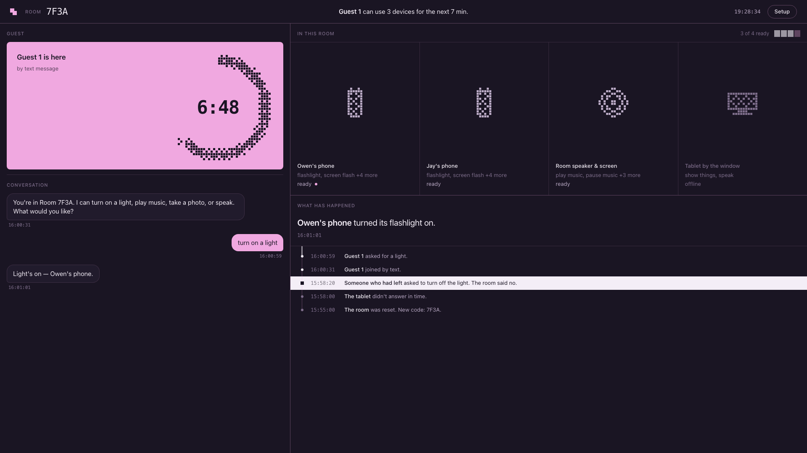
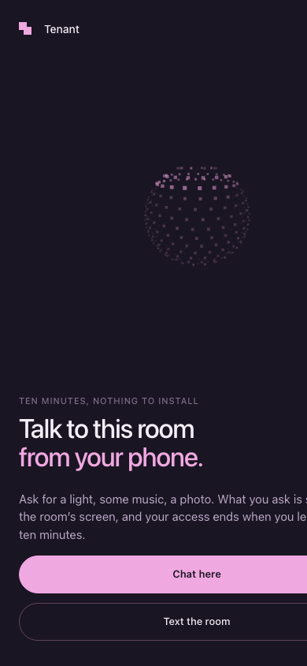
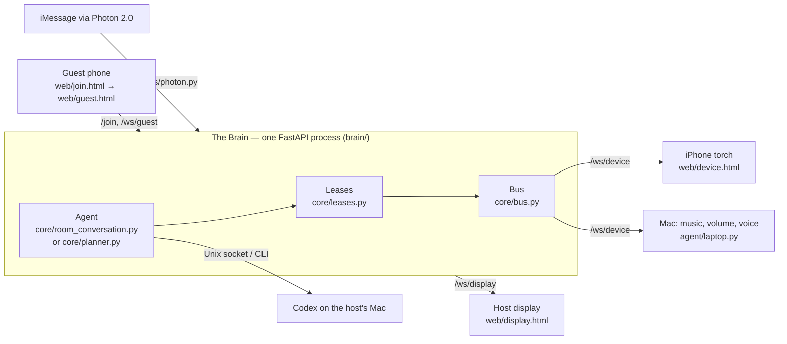

# Tenant

**Borrow a room's devices by talking to it. No app, no account, and it forgets you when you leave.**

Tenant gives a stranger temporary control of the devices in a space they don't own — a hospital bed, a hotel room, an Airbnb. You scan a card on the table, land in a chat with the room, and ask the way you'd text a friend: *"turn on a light"*, *"play something calm"*, *"say out loud: I need some help in here."* Something in the room does it and the room answers in one sentence. Your access is a **lease**, not an account: ten minutes and a specific set of devices. Say *leave*, run out of time, or let the host press one key, and the very next request is refused. The light stays however you left it; it was never yours.

Built in one weekend at DubHacks '26 by two people, with two iPhones, a MacBook and the speaker that was nearby. It controls real hardware (a phone's torch, the Mac's music, volume and voice) and it has been run end to end with real guests, including a full ten-minute natural expiry. It is a hackathon build: one room, one process, in-memory leases.

| | |
|---|---|
| Devpost | [dubhacks-2026.devpost.com](https://dubhacks-2026.devpost.com/) — the story, the video and the team |
| How it's built | [ARCHITECTURE.md](ARCHITECTURE.md): components, data model, wire protocol, lease lifecycle, failure behaviours |
| What we actually ran | [`notes/jay.md`](notes/jay.md) and [`notes/owen.md`](notes/owen.md): timestamped logs of every live run, with what passed, what failed and what is still unverified |
| The demo | [`notes/demo-final.md`](notes/demo-final.md): the three-minute script and the evidence behind each beat |

| The host's screen | The guest's first screen |
|---|---|
|  |  |

The display reads like a story rather than a log: who is in the room, how long they have left, which devices are online, and each action as a sentence ("Phone light turned its flashlight on"). No IDs, no tokens, no JSON on any screen a guest or host sees.

## Where to start

Five files show the whole loop. Everything else is detail.

| To see | Open |
|---|---|
| Why a lease that ended a second ago is refused | [`brain/core/leases.py`](brain/core/leases.py): `current()` is the only question anything asks before acting, and it is asked at the moment of the action, not when the guest joined or typed |
| How a request becomes a device command | [`brain/core/agent.py`](brain/core/agent.py) turns the guest's text into capability calls; [`brain/core/bus.py`](brain/core/bus.py) sends it with a deadline and the room's `epoch`, and waits for the device to say *done* |
| A phone as a room device | [`web/device.html`](web/device.html): Safari drives the torch through the camera track, holds a wake lock, ignores commands from an old epoch, and never replays an action after a reconnect |
| What the host sees and how it stays honest | [`brain/core/integration.py`](brain/core/integration.py) `snapshot()` publishes room, devices, guests and the sentence log over `/ws/display`; [`web/display.html`](web/display.html) renders it |
| What one key does | `reset()` in [`brain/core/integration.py`](brain/core/integration.py) revokes every lease, rotates the room code (so a photo of the old QR is useless) and clears the log *before* any cleanup is awaited; `reset_cleanup()` in [`brain/main.py`](brain/main.py) then turns lights off and pauses music and reports whether each device confirmed |

## What a judge asks

| Question | Answer in the repo |
|---|---|
| Does it move real hardware? | Yes. An iPhone's torch through [`web/device.html`](web/device.html); the Mac's music, volume and speech through [`agent/laptop.py`](agent/laptop.py). Both acknowledge each command, and the display only says "turned on" after the acknowledgement. |
| Does access really end? | Three ways: the guest says *leave*, the 600 s lease expires (120 s if they never send a message), or the host resets. Each is checked at dispatch time — [`test_access_core.py`](tests/test_access_core.py), [`test_guest_view.py`](tests/test_guest_view.py). |
| Where does the AI run and what can it touch? | One Codex conversation on the host's Mac ([`brain/core/room_conversation.py`](brain/core/room_conversation.py); a constrained Codex CLI planner in [`brain/core/planner.py`](brain/core/planner.py) is the fallback). Device actions go through the Brain's bus and its lease check; the model never holds a device token. |
| What does the model see about me? | A display name ("Guest 1"), your messages, and the room's devices. Phone numbers stay inside the Photon adapter; they are not shown on the display or written to the public log, which keeps sentences, not chat ([`brain/core/log.py`](brain/core/log.py)). |
| Can I text it instead of using a web page? | Yes, through Photon 2.0 ([`brain/channels/photon.py`](brain/channels/photon.py)). Give the join page your number and the room shows up in Messages. Inbound texts drove a real guest session; delivery of replies *to the handset* is the one claim we have not watched happen. |
| What happens when something fails? | The table below. The rule everywhere: an unknown outcome is reported as unknown, never retried on another device, never quietly repeated. |

## When this happens

Each row names what goes wrong, what Tenant does, and the test behind it.

| When this happens | Tenant | Proof |
|---|---|---|
| A guest says *leave* while a command is in flight | The command already sent is not cancelled (we never claim an undo); the acknowledgement is still recorded truthfully; the *next* request is refused | [`test_access_core.py`](tests/test_access_core.py) `test_inflight_ack_is_truthful_after_revoke` |
| A request waits in a queue and the lease ends meanwhile | Permission is re-checked after the wait; nothing is dispatched | [`test_access_core.py`](tests/test_access_core.py) `test_permission_rechecked_after_queue_wait` |
| A device never answers | The result is `UNKNOWN`. No retry, no fallback to a different device; the display says the outcome is unknown | [`test_access_core.py`](tests/test_access_core.py) `test_unknown_outcome_has_no_retry_or_fallback`, [`test_bus_dispatch.py`](tests/test_bus_dispatch.py) |
| The device you asked for is offline | The room offers the alternatives in plain text and waits for the guest to choose; it never picks for them | [`test_access_core.py`](tests/test_access_core.py) `test_ambiguous_alternatives_never_choose_for_guest` |
| The same phone connects twice | The original connection wins; the newcomer is closed with 1013 and retries without replaying anything | [`device-runtime.test.cjs`](tests/device-runtime.test.cjs) |
| A phone drops Wi-Fi and comes back | It re-announces itself and does **not** replay the last action; commands carry the room's `epoch`, so a stale command from before a reset is ignored | [`device-runtime.test.cjs`](tests/device-runtime.test.cjs), [`test_tenant_device_transport.py`](tests/test_tenant_device_transport.py) |
| The host presses reset | Every lease is revoked and the code rotates synchronously, then lights off and music pause are *observed*, not assumed; if a device doesn't confirm, the reset says so | [`test_app_integration.py`](tests/test_app_integration.py) `test_reset_requires_observed_defaults_not_only_success_acknowledgment`, [`test_room_cleanup.py`](tests/test_room_cleanup.py) |
| A guest sends a second message before the first is answered | Both are accepted; the second cannot steal or replay the first's reply, and *leave* always has reserved capacity | [`test_webchat_followups.py`](tests/test_webchat_followups.py) |
| A new guest joins after the last one left | The model's context is reset mechanically before their first message; the old guest's queued texts are denied | [`test_photon.py`](tests/test_photon.py) `test_new_guest_admission_resets_same_native_thread_and_denies_old_photon_queue` |
| Photon says "accepted" | We treat accepted and delivered as two different facts; an uncertain send is recorded once and never retried | [`test_display_projection.py`](tests/test_display_projection.py) `test_uncertain_photon_send_records_input_only_and_never_retries` |
| Someone opens the display from a different origin, or guesses a token | WebSocket refused; host actions require the host token; guest sockets require the guest's own token | [`test_guest_view.py`](tests/test_guest_view.py) `test_bad_token_or_origin_gets_no_initial_metadata`, [`test_room_setup.py`](tests/test_room_setup.py) |

## What we actually ran

Everything below was observed by a person on Saturday 17 October, and is logged with a timestamp in [`notes/jay.md`](notes/jay.md). We separate three kinds of evidence: *acknowledged* (the device said done), *observed* (a human saw or heard it), and *unverified*.

| Run | What it shows | What it doesn't show |
|---|---|---|
| A guest scans the card, taps *Chat here*, asks for a light; the phone's torch comes on | The full path works for a stranger with nothing installed; repeated all evening | Nothing about a second phone model or an Android browser |
| Natural ten-minute expiry with phone and audio connected, then a request after it | The lease ends on its own and the next request is refused with no command sent | — |
| *Leave*, then "turn off the light" from the same phone | The refusal is real; the light stays on | — |
| Host reset: torch off acknowledged in 0.35 s, music paused, code rotated, log cleared | One key returns the room to a clean state | The aggregate "cleanup confirmed" flag was sometimes *unconfirmed* when the Mac's pause queued behind narration |
| A real iMessage guest through Photon drove music and phone pulses for a full session | Inbound texts reach the same agent and the same lease | That the room's **replies** arrived on the handset; Photon accepted them, nobody watched one land |
| The Mac spoke "Hello from Tenant" on a guest's request | Speech works end to end at 20% volume | One speech turn hung for 54 s earlier in the night; speech is the least reliable path |
| Phone torch pulsed to a beat: 60 acknowledged edges in 59 s, zero failed, median round trip 98 ms | The device bus can sustain a stream of commands | Optical sync — transport timing is not what the eye sees |
| Phone photo → Mac display | Backend and viewer exist and pass their tests ([`tests/test_photo_*.py`](tests)) | No real photo has landed on the display; the demo phone advertises light only |

## How it's built



A device connects to `/ws/device` with the device token and says hello: *I am "Phone light", I can `light`*. The Brain keeps that registry. A guest joins with the room code and gets a lease (`joining` for 120 s, `active` for 600 s from creation; activation never extends it). Each message goes to the agent, which may call device capabilities; the Bus checks the lease at that instant, sends `{type: "do", cap, args, deadline_ms, epoch}` to the device, and waits for `ok` or `err`. The display is a projection of the same state, published whenever it changes.

| Path | What it is | Tests |
|---|---|---|
| [`brain/`](brain) | FastAPI server: registry, leases, bus, agent adapters, Photon channel, photo pipeline, host console | [`tests/test_*.py`](tests) |
| [`web/`](web) | Every screen a human sees: `join.html`, `guest.html`, `display.html`, `setup.html`, `device.html`, `slides.html`; one stylesheet `tenant.css`; `?mock=1` fixtures in `web/mock/` so each page runs without a Brain | [`tests/device-runtime.test.cjs`](tests/device-runtime.test.cjs), [`tests/photo-viewer*.test.cjs`](tests) |
| [`agent/`](agent) | The Mac bridge (`laptop.py`), audio helpers, and the native-agent session glue | `tests/test_laptop_audio.py`, `tests/test_room_session.py` |
| [`scripts/`](scripts) | `dev.sh` (foreground Brain), `runtime.py` (detached brain / audio / tunnel services) | `tests/test_runtime.py` |
| [`notes/`](notes) | The hackathon record: per-person logs, demo script, handoffs, evidence manifests in `tests/evidence/` | — |

Design choices, briefly: in-memory state because one room and one process is the honest size for a weekend; the lease check lives in one function so there is one place to get it wrong; absolute commands (*light on*, never *toggle*) so a replay can't flip state; the model gets tools scoped to the guest's lease rather than a filter on its output; sentences on every screen because the host and the judge should never need to read JSON.

## Running it

Python 3.12 and the pinned dependencies in `requirements.txt`. Create a private `.env` from [`.env.example`](.env.example): separate random `HOST_TOKEN` and `DEVICE_TOKEN`, a `ROOM_CODE`, and the public HTTPS `PUBLIC_URL` phones will use (the Brain only accepts same-origin requests, so the display must be opened through the same URL). The Photon fields are optional; web chat works without them.

```sh
uv venv --python 3.12 .venv
uv pip install --python .venv/bin/python -r requirements.txt
sh scripts/dev.sh                       # Brain on :8000, serves the pages
```

On the room Mac, in a second terminal, start the bridge (it never changes your output device or volume on its own):

```sh
uv run --env-file .env .venv/bin/python agent/laptop.py --check
uv run --env-file .env .venv/bin/python agent/laptop.py
```

For a demo that outlives the terminal, use the detached launcher: `.venv/bin/python scripts/runtime.py start brain|audio|tunnel` (`status`, `stop`). The tunnel's address lasts only while it runs; set `PUBLIC_URL` to it and restart the Brain after a change. Restarting the Brain ends guest sessions.

Then: open `/setup` on the Mac to name the room and enrol a phone with the device QR; open `/display` on the TV; print `/qr.svg` or hand the phone the join URL. Each page also runs alone with `?mock=1` for design work.

The agent needs a signed-in Codex on the host's Mac: `TENANT_AGENT_MODE=conversation` with the app-server socket for the native conversation, or the default `planner` for the constrained Codex CLI path (version pinned in `brain/core/planner.py`).

```sh
.venv/bin/python -m unittest discover -s tests -p 'test_*.py'
node --test tests/device-runtime.test.cjs
```

## Honest limits

- One room, one process, leases in memory. `TENANT_STATE_PATH` persists only the room's identity, epoch and enrolled device aliases.
- Devices are what two people had: an iPhone torch and a Mac. A hotel TV or a smart bulb would join the same way, but none has.
- Photon reply delivery to a handset is unverified. Photos are built and tested but have not been demonstrated on real hardware. Speech is the least reliable path.
- "Stop" cannot undo a physical effect already started; Tenant reports what it knows and refuses to guess.
- The Codex agent runs with the host's own sign-in. Tenant's lease check gates *device* actions; it is not an operating-system boundary around the host's machine.

## More

- [ARCHITECTURE.md](ARCHITECTURE.md): the spec the code was written to, kept current as the protocol changed.
- [`notes/plan/`](notes/plan): the original plan and per-person worklists from Saturday morning, kept as written.
- [`notes/`](notes): the running record — `jay.md` and `owen.md` logs, `demo-final.md`, `devpost-draft.md`, handoffs between the two halves, and screenshots in `notes/shots/`.
- [`tests/evidence/`](tests/evidence): JSON manifests for the live runs, separating acknowledged, observed and unverified results.
